# Tracker Looper

A from-scratch 4-track looper firmware for the original Polyend Tracker. The
app is new; the hardware layer (board bring-up, SDRAM, FT81x display,
SGTL5000 codec, keypad, pad LEDs, SD card, USB) is copied from
[OpenTracker](https://github.com/sandlbn/polyend-tracker-re), MIT, the same
way [SIDTracker](https://github.com/sandlbn/SidTracker) does it. See
`PROVENANCE.md` for exactly what was copied.

> [!WARNING]
> **Very beta.** This runs on the Tracker and is being tested on the device,
> but expect bugs and performance issues (audio glitches, a slow screen under
> load). Keep the stock firmware on the SD card as the way back (see
> [Install on a Tracker](#install-on-a-tracker)), and don't trust it with
> anything you can't afford to lose.

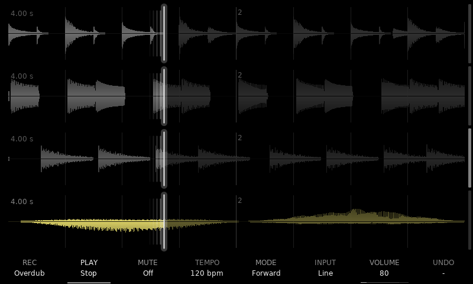

- A looper: four stereo tracks, locked to one bar clock
- Record, overdub, replace (punch in), undo and redo
- Recording latency compensation, measured with a patch cable
- Takes up to 5 minutes per track, streamed from the SD card
- Count-in, start on sound, stop on the bar or beat, fixed lengths
- Click-free loop points
- Playback modes: reverse, ping-pong, half and double speed, half time, octave up / down
- Granular playback, with the grains drawn on the waveform
- Tempo changes as tape varispeed or time-stretch, tap tempo
- Two send effects: delay, ping-pong, reverb, chorus, flanger, Mutable Instruments Clouds
- A mixer with sends, returns, FX chaining, meters and mutes
- Performance mode: beat repeats, filters, sweeps, vibrato, tape stop, on one track or all at once
- A loop editor: trim, cut, erase
- Projects saved to the SD card, WAV export
- MIDI clock in and out, learnable footswitch actions
- Metronome, input monitoring through the effects
- An on-device manual, and a firmware flasher back to stock

## Features

### Four stereo tracks on one bar clock

Each track records up to about 21.5 s of stereo (43 s mono) in the Tracker's
16 MB SDRAM, and with an SD card up to **5 minutes** (10 mono): a longer take
goes on to the card (see Long takes below). The first take sets the bar; every later take, every playback
mode and every effect follows the same bar clock, so nothing drifts. Takes
start with a count-in (or at once, or when sound arrives), stop on the bar
line, and blend their end into their start so the loop point does not click.
Overdub (with feedback), replace (punch in), undo and redo. Takes and
overdubs are placed back by the codec's round-trip delay (Config > Rec
latency, measured with a cable from an output into the input), so layers
land where they were played and do not drift.

The home page is the four waveforms, left channel above the line and right
below, with the bar and beat lines. The playhead leaves a fading trail as
long as its speed, on the side it came from. The eight screen keys act on
the selected track and show its state.

A take in progress, a pulsing dot by the lane's tag, the REC key showing what a press does:

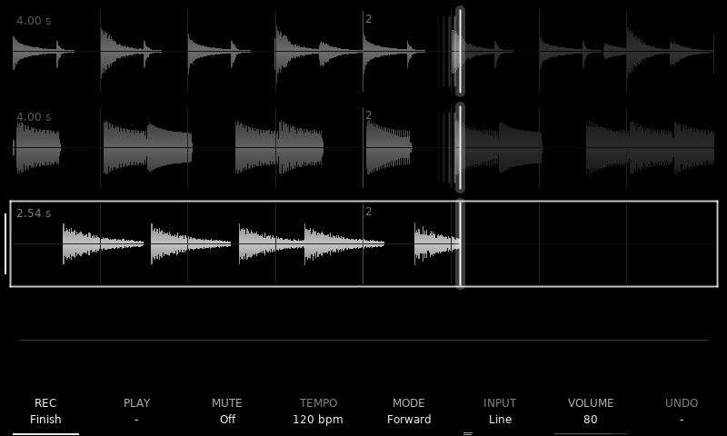

### Long takes on the SD card: up to 5 minutes a track

With a card in, a take is no longer limited by RAM: past about 19.5 s it
keeps recording onto the card, up to 5 minutes stereo (10 mono) per track.
Nothing changes in how it plays: overdub, replace, undo / redo, every mode,
tempo changes, jumps, the effects, the editor, saving and loading all work
on it. Its lane says **card**. Below, track 1 is a 24 s take with the chord
stabs overdubbed over its first half (undo is ready on F8), next to two
ordinary 4 s loops. How it works is under
[How the SD card streaming works](#how-the-sd-card-streaming-works).

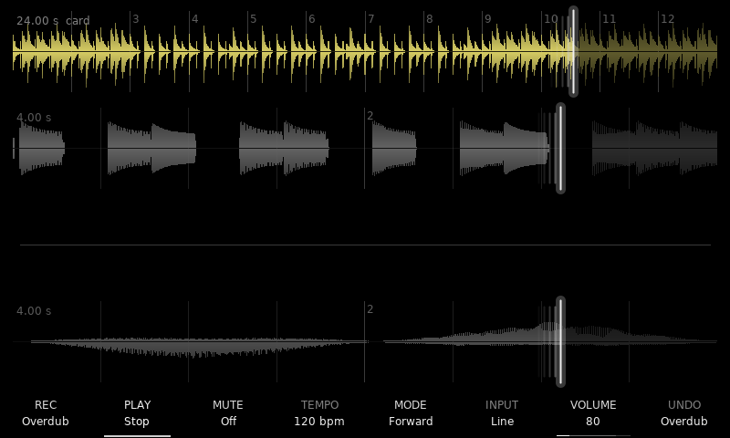

### Playback modes

The mode bar (F5) has two pages: Forward, Reverse, Ping-pong, Half speed,
Double, Half rev and Double rev; then Half time, Octave up, Octave down and
Granular. Each mode reads from the bar clock, so a track stays in time in any
mode and a switch carries on from where it is.

| Page 1: playback | Page 2: grains |
|---|---|
| 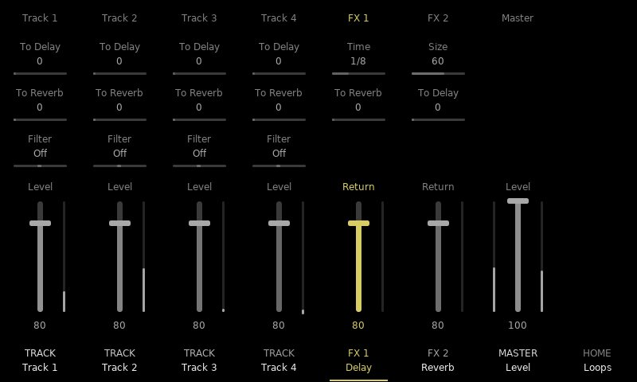 | 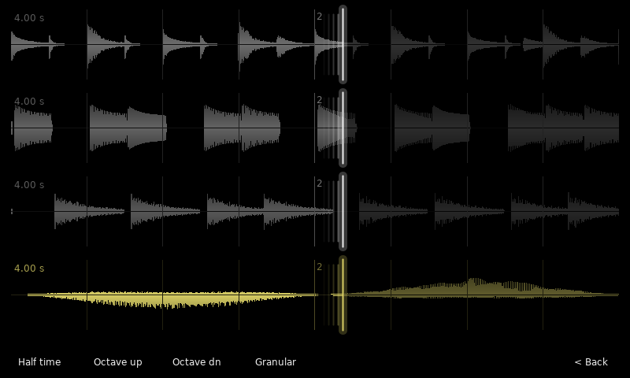 |

**Granular** plays the loop through Clouds grains around the playhead. Hold
F5 for the grain menu with its four knobs (Spread, Size, Density, Pitch); it
stays open until F5 again. The lane draws every
grain where it reads, as long as it is and as bright as it sounds. Below,
track 2 plays in Half rev (the trail on the right of its playhead) and track 4
is Granular, its grains scattered by Spread:

| Grain knobs | Grains on the lane |
|---|---|
| 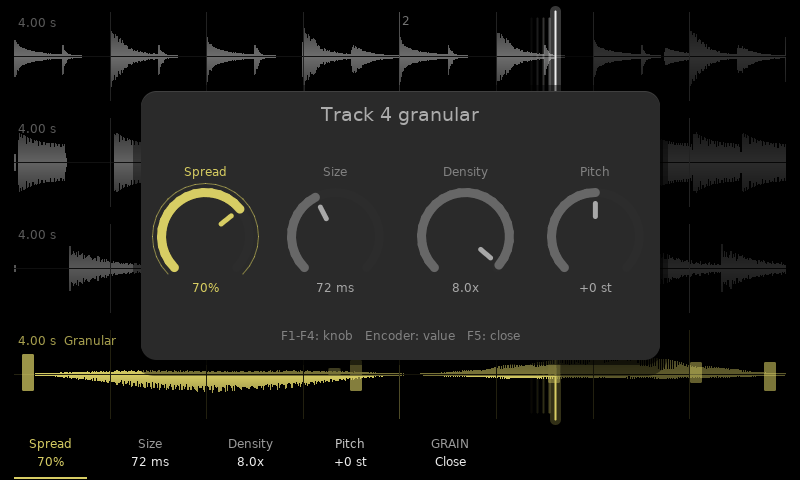 | 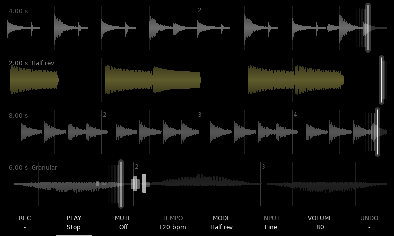 |

### Shift layer: track options

Holding Shift relabels the screen keys: Replace, Play / stop all, Solo, Click
level, then the selected track's options: Stop (free / on bar / on beat, or a
fixed length in bars), Start (now / count-in / on sound, with its threshold),
After rec (play / overdub / stop) and Tempo (Tape or Stretch).

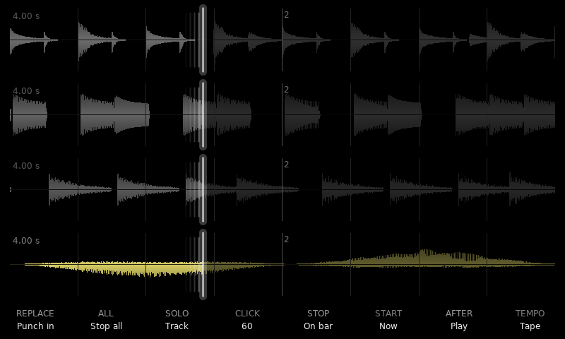

A track set to start on sound waits armed (a ring by its tag), showing the
input level against the threshold:

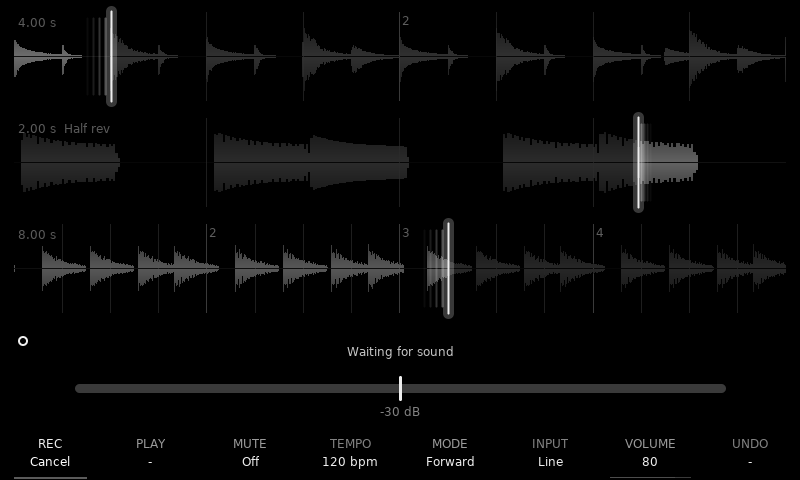

### Tempo, volume and input, under your fingers

Hold F4 and turn for the tempo: before a loop it sets the bar, after it it is
tape-style varispeed from 50 to 200 % (Stretch tracks keep their pitch). Hold
F7 for the selected track's volume; hold F6 for the input gain, tap it for the
Input page (source, gain, channels, monitoring through the effects, overdub
feedback, and the tempo card: metronome, click, beats per bar, stop fade).

| Tempo (F4) | Volume (F7) |
|---|---|
| 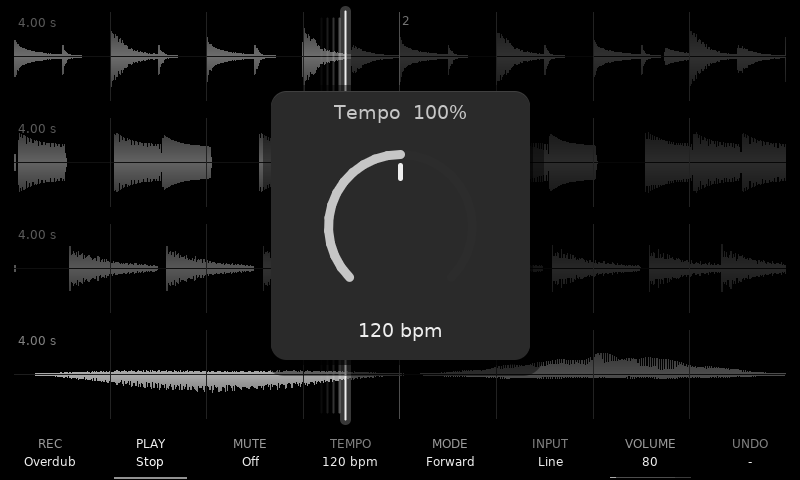 | 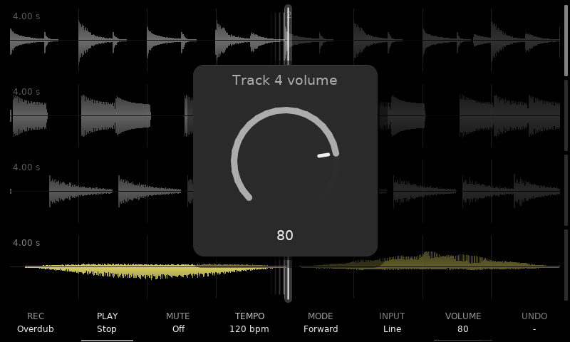 |

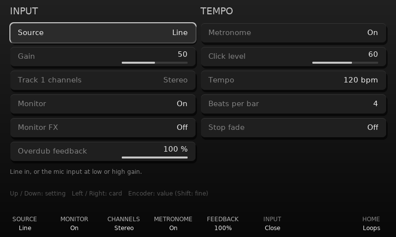

### Two send effects, including Clouds

FX 1 and FX 2 each hold a Delay, Ping-pong delay, Reverb, Chorus, Flanger or
Mutable Instruments' Clouds granular processor. Each page shows the effect
live (echo taps, the reverb's decay, LFOs, Clouds' grains in its buffer) over
its knobs. One slot can feed the other, so Clouds can run into the reverb.

| Reverb | Clouds |
|---|---|
| 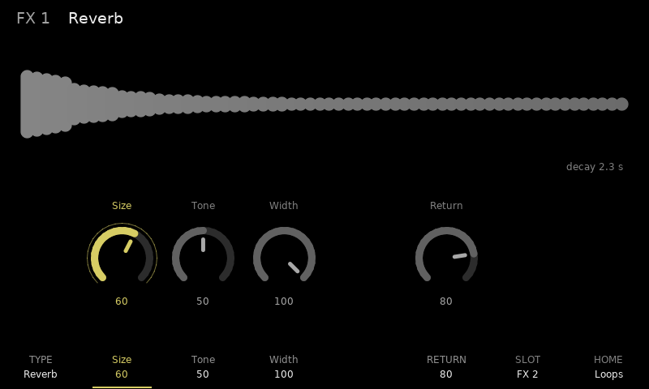 | 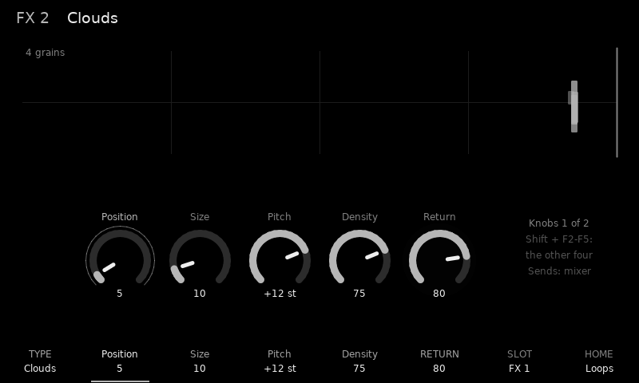 |

### Mixer

Master opens seven strips: per track the two pre-fader sends and the level,
per FX slot a knob, the chain send to the other slot and the return, and the
master, with meters on every fader. Hold Shift for the mutes on F1–F4.

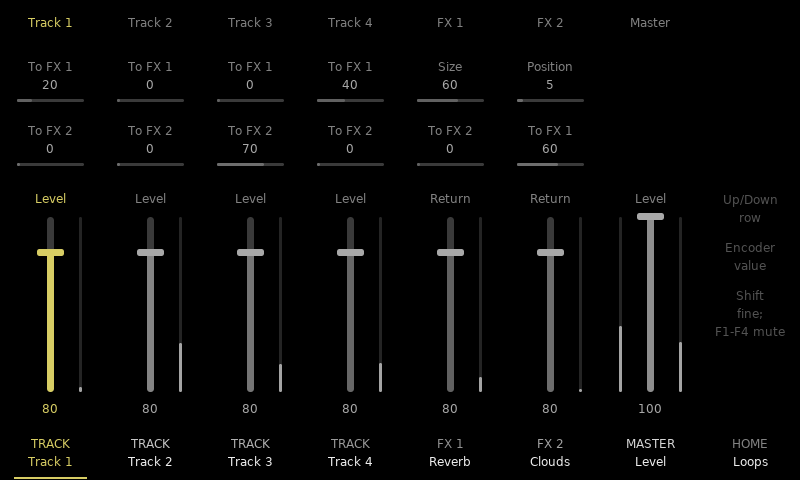

### Performance mode

Perform turns pad columns 5 to 12 into eight effects per track: two beat
repeats, low-pass, high-pass, two filter sweeps, vibrato and tape stop. Hold
a pad to play one, Shift + pad to latch it; play as many as you like on as many
tracks at once. The screen keys become the eight effects' knobs: hold one and
turn the encoder. Repeats and tape stop land back in time when released, and
the playhead shows where they read. On the mixer, Perform turns the screen keys
into the eight effects for **every track at once**.

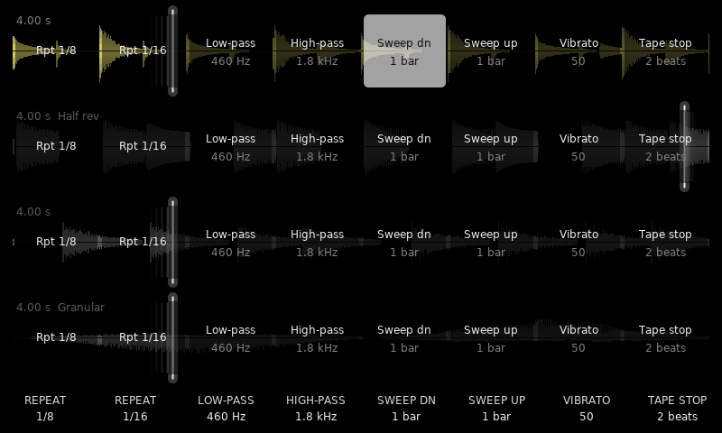

### Loop editor

Instr opens the selected track's waveform with start and end markers on a
bar / beat / 1/16 grid: trim (instant, with undo), cut and erase.

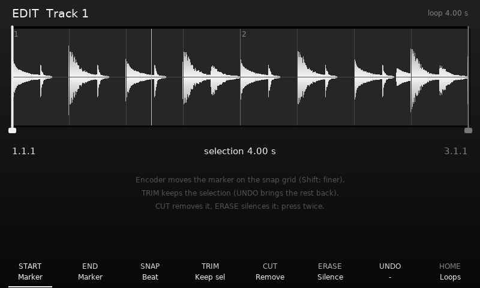

### Projects, export, settings, MIDI and the manual

File saves and loads projects (every loop as a WAV plus all settings) and
exports tracks as WAVs, in the background while the loops play. Config holds
the settings, the recording latency, a firmware flasher (the way back to the
stock firmware) and MIDI: clock out or follow, and eight learnable footswitch actions. Song opens
a seven-chapter manual on the device.

| File | Config |
|---|---|
| 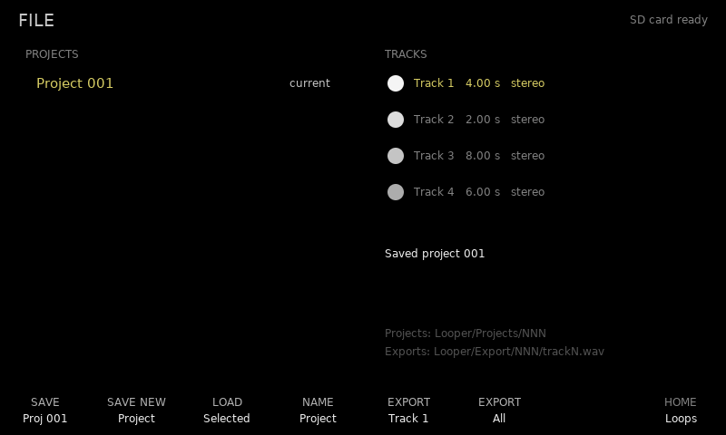 | 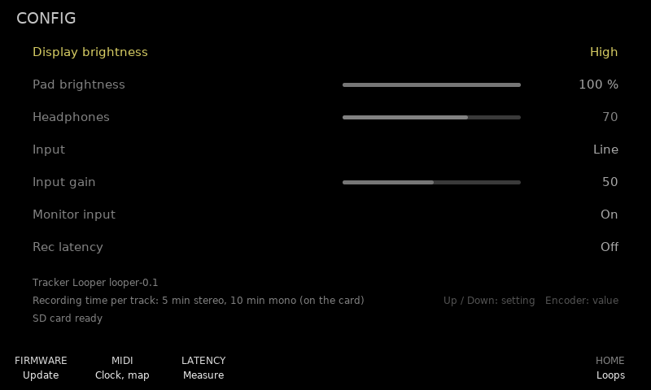 |

| MIDI | Manual |
|---|---|
| 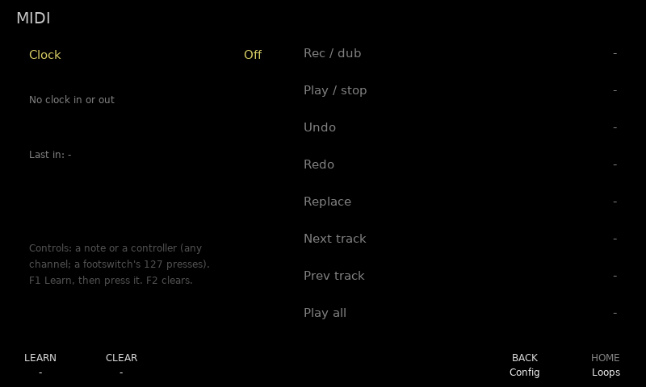 | 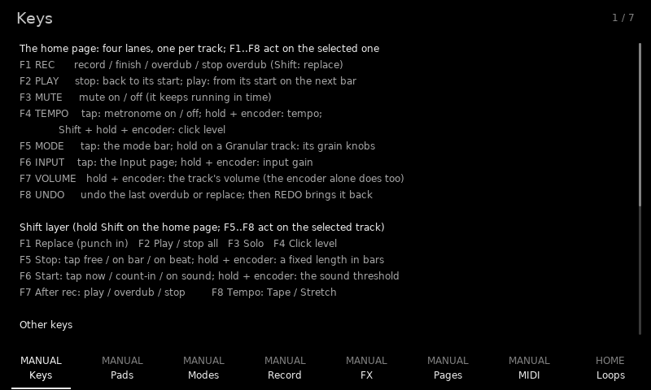 |

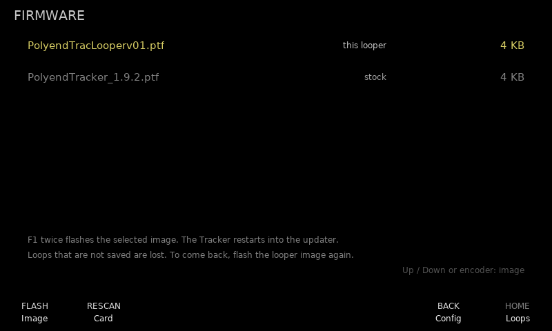

# Reference

## Layout

| Path | What |
|---|---|
| `src/looper/engine.*` | The audio engine: 4 stereo tracks, master length, overdub, mute, jump. No hardware headers. |
| `src/looper/app.*` | Input, pad LEDs and the screen, drawn straight on the FT81x display list. |
| `src/looper/stream.*` | Long takes on the SD card, the main loop's side: the stream files, read-ahead, write-back, undo, edit jobs. |
| `src/looper/files.*` | Settings, projects (save / load) and WAV export, as background jobs. |
| `src/looper/manual.h` | The on-device manual (Song). |
| `src/looper/platform.h` | Everything the app needs from outside (display, audio, input, LEDs, clock, memory). |
| `src/device_main.cpp` | Device glue: HAL drivers + 16 MB SDRAM into `looper::Platform`. |
| `src/main.cpp`, `src/hal/`, `src/platform/` | Copied from OpenTracker (boot, drivers, display interface, fonts). |
| `sim/` | Desktop simulator: OpenTracker's host HAL plus a new `main.cpp` with a headless script runner. |

## Build

Needs `arm-none-eabi-gcc` + newlib, GNU make, Python 3 (firmware), and g++ + SDL2 (simulator).

```
make                 # build/PolyendTracLooperv01.ptf, also in build/sdcard/Firmware/ (copy that folder onto the SD card)
make SELFTEST=1      # OpenTracker hardware selftest image
make sim             # build/sim/looper-sim
make -C sim check    # headless test scripts (sim/scripts), screenshots in build/sim/check/
make -C sim asan     # build/sim-asan/looper-sim: the simulator with AddressSanitizer + UBSan
make -C sim soak     # long random sessions on the asan build (SEEDS="1 2 3" MINUTES=60)
```

**Soak.** `looper-sim --soak SEED --minutes N` plays a random user for N
minutes of simulated time (about 30x faster than real time): pads, keys,
the encoder, held keys and pads, the input changing, long takes on a slow
simulated card, tap tempo, every page, and every ten minutes a project saved,
loaded back and compared. After every action it checks each track's state
and loop bounds, card errors and the display-list size; the asan build stops
at the first bad memory access. The same seed replays the same session, and
`--soak-log FILE` lists every action with its time. Run a few seeds before a
release.

`sim/scripts/stereo.txt` checks that left and right stay separate through
record, playback and overdub; `--tone-ch left|right|both` puts the simulator's
test tone on one channel when you run it interactively.

## Run the simulator

```
build/sim/looper-sim --tone 330      # synthetic input
build/sim/looper-sim --line-in       # the host microphone
tools/readme_shots.sh                # the README screenshots (docs/img), from example loops
```

Scripts can feed a WAV file into the input with `input_wav PATH` (16-bit,
44.1 kHz, mono or stereo, looped; `input_wav off` stops it).

Keyboard: the four rows `1..=`, `q..]`, `a..'`, `z../` are the pad rows
(row = track). Enter = Rec, Space = Play, Backspace = Delete, F1..F8, Up/Down,
mouse wheel = encoder. The panel is clickable.

## Controls

The screen is the four track lanes and, along the bottom, the labels of the
eight screen keys, each centred over its key as on the stock Tracker. The whole
interface is greys and one colour: every page is plain black with no cards or
boxes, and whatever is selected (a lane, a row, a strip, a knob, a picked
mode) is drawn in the yellow of the DIY norns shield's OLED, the rest
in dimmer greys; on the lanes only the selected track's waveform (or its line,
when empty) turns yellow. The four tracks are told apart by slightly different greys (only
the popups over the lanes keep a backing, to stay readable). The lanes
are waveforms only, the full width of the screen; a tag in each lane's corner
gives its length and, when they apply, **card** (a long take), its mode
(other than Forward) and Muted. A lane that records has a pulsing dot before its tag (a ring
while it is armed or counting in). The selected track's state is on the keys: REC lights up while it
records (brightest, pulsing; a softer pulse for an overdub, dim during a count-in
or while armed), PLAY lights while it plays (dim while it waits for its bar line), MUTE
while it is muted.

| Screen key | Action (selected track for F1–F3, F5, F7) |
|---|---|
| F1 REC | Record / finish / overdub / stop overdub |
| F2 PLAY | Stop: the track goes silent and back to its start. Play: it starts again from its start on the next bar line (press again to cancel) |
| F3 MUTE | Mute on/off |
| F4 TEMPO | Tap: metronome on/off (the label is bright while it is on). Hold + encoder: tempo, 1 bpm a step (a knob shows while held). Shift + hold + encoder: click level. Delete clears tracks |
| F5 MODE | Tap: the mode bar, two pages of playback modes; the key under one picks it, F8 in the bar turns the page (it opens on the page with the track's mode). Any other key closes it. Hold on a Granular track: the grain menu, which stays open (F1–F4 pick a knob, the encoder turns it, F6–F8 are blank, F5 closes it) |
| F6 INPUT | Tap: the Input page (the cell shows the source and the input level). Hold + encoder: input gain (a knob with the input level shows while held) |
| F7 VOLUME | The selected track's volume, with its output level in the cell. Hold + encoder: a volume knob (the encoder alone sets it too) |
| F8 UNDO | Undo the last overdub or replace; after an undo it reads REDO and brings it back |

**Input page** (F6): two cards. Up/Down pick a setting, Left/Right the card, the
encoder sets it (Shift: fine steps); F6 or F8 closes it.

| Input card | |
|---|---|
| Source | Line in / mic low / mic high |
| Gain | Codec input gain, with the live input level under it |
| Track N channels | Stereo / Mono L / Mono R / Mono sum for the selected track (only while it is empty) |
| Monitor | Hear the input through the outputs |
| Monitor FX | Off / FX 1 / FX 2 / Both: hear the input through the effects too (full send); takes stay dry |
| Overdub feedback | How much of the loop stays under each pass, 0–100 % |

| Metronome card | |
|---|---|
| Metronome | Click on every beat (count-ins click either way) |
| Click level | Click volume |
| Tempo | As F4: the bar before there is a loop, tape speed after |
| Beats per bar | 1–12 |

Quick keys on the page: F1 next source, F2 monitor on/off, F3 next channel
mode, F4 metronome on/off, F5 feedback 100 / 90 / 75 / 50 %.

**Shift layer.** Holding Shift on the home page relabels the F-keys; F5–F8
are the selected track's options (see Track options below):

| Shift + | Action (selected track) |
|---|---|
| F1 REPLACE | Punch in: record over the loop instead of on top of it; again to stop |
| F2 ALL | Play / stop all (the transport, as Play) |
| F3 SOLO | Mute every other track; again: everything back |
| F4 CLICK | Hold + encoder: click level |
| F5 STOP | Tap: Free / On bar / On beat. Hold + encoder: a fixed length in whole bars, or off |
| F6 START | Tap: Now / Count-in / On sound. Hold + encoder: the sound threshold (with the input level) |
| F7 AFTER | Tap: Play / Overdub / Stop after the take |
| F8 TEMPO | Tap: Tape / Stretch |

| Other control | Action |
|---|---|
| Pad column 1 | Record / overdub (empty → record → play ↔ overdub); Shift + pad: replace |
| Pad column 2 | Stop / play the track, as F2 |
| Pad column 3 | Mute |
| Pad column 4 | Clear |
| Pad columns 5–12 | Jump to that eighth of the loop, keeping the phase (stays in time) |
| Rec | Record / overdub the selected track; Shift + Rec: replace |
| Insert | Undo the last overdub / replace (Shift: redo) |
| Encoder push | Tap tempo: three taps or more (before a loop: the bar; after: the tape speed) |
| Play | Transport: everything stops, or starts from bar 1 (what was playing plays, stopped tracks stay stopped); Shift + Play: metronome on / off |
| Delete | Clear the selected track; Shift + Delete clears all |
| Up / Down, any pad | Select track |
| Encoder | Selected track volume; Shift + encoder = input gain |
| Note | Home: the loop lanes, from any page |
| Master | Mixer page on / off |
| Instr | Loop editor for the selected track |
| FX1 / FX2 | That effect slot's page on / off |
| Config | Settings page (F1 firmware, F2 MIDI, F3 measure the recording latency) |
| File | Projects (save / load) and WAV export |
| Shift + Config | Show / hide the CPU, frame-rate and display-list readout (Help too, if the panel has one) |
| Shift + File | Stress preset (Shift + Help too) |
| Song | The manual: chapters on F1–F7, Up / Down or the encoder scroll, F8 home |
| Power (hold 1.5 s) | Switch off |

### Config, projects and export

**Config** opens the settings; Up/Down pick one, the encoder sets it. They are
saved to `Looper/config.bin` on the card a second after a change and loaded at
start-up: display brightness (low / medium / high), pad brightness, headphone
level, input source, input gain, input monitoring (these three are the same
settings as on the Input page) and **Rec latency**. The page also shows the
version and the recording time per track.

**Rec latency** (Config, last row; **F3** measures it): what comes in at the
input is late by the codec's round trip, so a take or an overdub played in
time would land that much late, and layers would drift. Playback reads that
far ahead of the bar clock and overdubs write at the clock, which puts them
back. Off by default. To set it, patch an output (line out or headphones)
into the input and press **F3**: the outputs go quiet but for seven short
clicks, the input times them, and the median is set and saved. The encoder
also sets it by hand, 0.5 ms a step (Shift: a frame), up to 30 ms.

**Config > F1 Firmware** lists the update images in `/Firmware` (the names the
update bootloader takes: `PolyendTrac*.ptf`, `mt*.hex`), with this looper's
image and the stock one marked. Up/Down or the encoder picks one, **F1 twice**
flashes it (the Tracker restarts into the updater; unsaved loops are lost),
F2 rescans the card, F7 back, F8 home. This is the way back to the stock
firmware or OpenTracker, and the way to install a new looper build.

**File** opens projects and export:

| Key | Action |
|---|---|
| F1 SAVE | Save over the current project (the first save makes a new one) |
| F2 SAVE NEW | Save as the next numbered project |
| F3 LOAD | Load the selected project (Up/Down); press twice, it replaces the loops you have |
| F5 EXPORT | The selected track as a WAV |
| F6 EXPORT | Every track with a loop as WAVs |
| F8 HOME | Back to the lanes |

A project is a folder `Looper/Projects/NNN`: `project.bin` and `trackN.wav` per
track with a loop (16-bit, stereo or mono as recorded). It holds the tempo and
bar, each track's length, place on the bar grid, play / stop, mode, level,
mute, sends and options, both FX slots, returns, master, the performance knobs,
the metronome and the feedback. Loading clears the tracks, reads the WAVs back
(progress bar) and leaves the transport stopped: Play starts everything from
bar 1. Exports go to a new folder `Looper/Export/NNN` each time (the highest
number on the card plus one, up to 999). Saving and exporting run in the
background in 16 KB steps, so the audio and the screen keep going.

A save writes new files next to the old ones (`trackN.tmp`, `project.tmp`)
and swaps them in only when all of them are written, so a save that fails
(a full card, the card pulled) leaves the last good save as it was; a power
cut during the swap is finished at the next load. While a job runs, the
tracks it still needs are held: recording is refused during a load, and
clearing, undo and the editor's edits on a track being saved or exported.
A load that has to leave a track out (an unreadable or non-44.1 kHz WAV, a
long take with no card ready) says which, and F1 then saves a new project
instead of overwriting the original.

### Long takes (on the SD card)

With a card in, a take that outgrows its RAM (past about 19.5 s stereo, 39 s
mono) keeps going onto the card, up to 5 minutes stereo or 10 mono per track.
Every take is written to the card as it records; one that grows past its RAM
keeps its first part there and streams the rest through a 2 s buffer, read
ahead of the playhead in whichever direction it plays. The lane's tag reads
**card**. Each track has two files, `Looper/Stream/trackN.raw` and
`trackN.b.raw` (53 MB each, 424 MB in all, allocated once when the card is
first seen and then kept).

A long take does everything a RAM loop does: overdub and replace, every
playback mode, any tempo, jumps (a moment of silence while the buffer
refills), the performance effects, the loop editor, saving, loading and
exporting. **Undo / redo**: an overdub pass writes the blocks it changes to
the track's other file, so the pass before stays there; undo switches back to
it (the track is silent for a moment while its RAM part reloads), redo
switches again. The editor's trim is instant; cut and erase work through the
card, so on a long take they take a few seconds (the track is silent
meanwhile). A project load puts a long track's first part in RAM and the
rest in its stream file. One difference: in **Granular**, grains on the card
part stay inside the 2 s buffer around the playhead, so Spread reaches about
a second either way there instead of the whole loop.

The card matters: see [The SD card](#the-sd-card) below.

### The SD card

- **FAT32.** exFAT is not supported (the build leaves it out), and cards over
  32 GB come formatted exFAT: reformat them FAT32 (the SD Card Formatter only
  does exFAT on those, so use a tool that can, or a card of 32 GB or less).
- **32 KB clusters** (allocation unit). The SD Card Formatter's default for
  8 to 32 GB cards. FatFs sends at most one cluster per card command, so with
  small clusters (4 KB) writing is too slow for long takes: measured on an
  8 GB card, 1.7 MB/s against 8 MB/s with 32 KB clusters.
- **Room:** 424 MB for the stream files (two of 53 MB per track), allocated
  once in one contiguous run each, so a freshly formatted card is best; then
  the projects and exports. With no room the looper still works, with takes
  up to the RAM's 21.5 s (Config shows the recording time).
- **Speed:** a decent card (Class 10 / U1 or better). Four tracks playing long
  takes need about 0.7 MB/s, four overdubbing 1.4 MB/s.
- Keep `PolyendTracker_1.9.2.ptf` in `/Firmware` as the way back.

### How the SD card streaming works

The design notes, measurements and phases are in `docs/SD_STREAMING.md`;
this is the short version.

**Two threads, one rule.** The audio runs in an interrupt every 128 frames
(2.9 ms) and must never wait, so it never touches the card: it only reads
and writes the Tracker's 16 MB SDRAM. Everything on the card is done by the
main loop (`Streamer`, `src/looper/stream.cpp`), one card command per track
per pass. They share a small block of atomics per track
(`StreamView` in `engine.h`): who owns which part of the memory, how far the
card has caught up, what the ring holds.

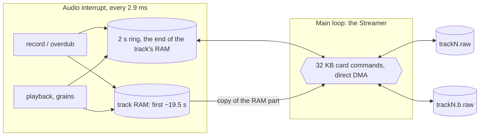

**Files.** Each track has two stream files on the card, A and B, 53 MB each
(5 minutes of stereo), created with FatFs's `f_expand` as one contiguous run
of clusters without writing any data, and kept from then on. The files
mirror the track's buffer frame for frame, so a frame's place in the file is
just its index times 4 bytes (2 for mono). FatFs's fast-seek map keeps
jumping around in them free of FAT lookups.

**Recording.** Every take with a stream file ready is copied to file A as it
records (a short one simply stops being copied when it ends). A take that
reaches `head`, its RAM less the last 2 s, becomes a long take: from there on
the frames go into a 2 s **ring** in that last part of its RAM, and the
Streamer drains the ring to the file in 32 KB commands. If the card falls a
whole ring behind (2 s), the take ends there rather than lose audio in the
middle; the end of the last bar is padded with zeros on the card.

**Playback.** The first `head` frames play straight from RAM. The rest play
from the ring, which the Streamer keeps filled from the file around the
playhead: from 0.5 s behind it forwards when it reads forwards (the half
second behind is there for beat repeats and grains), from 0.5 s after it
backwards in the reverse modes. While a loop plays its RAM part, the ring is
already filled with what comes next on the card: the start of the card part,
or its end for a reverse loop about to wrap. A frame the ring does not hold
plays as silence and is counted (`under` in the telemetry): a jump pad into
the card part does that for a moment while the ring refills.

**Overdub.** An overdub mixes into RAM or the ring, then marks the 32 KB
**block** it changed. A changed block goes back to the card once the
playhead has left it, as one 32 KB command; before the ring moves (a jump,
the loop's wrap) it is emptied first, so the overdub stops writing into it,
and every changed block is written back before its slots are reused.

**Undo on the card.** The Streamer keeps a map of which file, A or B, holds
the current version of each block. An overdub pass writes each block's
first change to the *other* file and flips the block in the map, so the
version from before the pass stays untouched in the first file. Undo writes
everything back, flips that pass's blocks back, reloads the RAM part's
blocks from the card, recomputes their waveform and refills the ring; redo
flips them again. Like the RAM undo it is one level: the next pass starts a
new set.

**Edits, projects.** A trim only moves the loop's start and end over the
buffer (the file mirrors the buffer), so it is instant. Cut and erase are
Streamer jobs that work through RAM and the card (cut moves the rest of the
take up through a 32 KB staging buffer); saving and exporting read the take
the way it plays now (RAM, the ring where an overdub has not gone back yet,
each block's current file); loading writes a long WAV's first part to RAM
and all of it to file A.

**Granular** grains read either the RAM part or the ring, each grain wholly
one or the other: a grain is kept off the RAM part's edge and the loop's
end, and inside what the ring holds, with its own length to spare because
the ring moves on while it plays.

**Speed.** On the 8 GB test card formatted with 32 KB clusters, with direct
DMA into the SDRAM (verified on the device: thousands of transfers, every
word checked), in-place writes ran at 8 MB/s and reads at 16 MB/s, the
worst write stall 166 ms. Four tracks playing need 0.7 MB/s, four
overdubbing 1.4 MB/s, so the card is busy a small part of the time and the
2 s ring rides out the stalls. Card commands block the main loop while they
run (~2–4 ms for 32 KB), which the screen and pads can afford; the audio
never waits. The serial telemetry line ends with
`stream under N over M err E` (frames played as silence, takes cut short,
failed card commands).

### Loop points, punches and undo

- **Loop point**: a take records 5 ms past its end and blends that into its
  first 5 ms, so the end runs on into the start with no click (the loop stays
  exactly on the bar). A take that starts after silence in its loop (mid-bar)
  fades in over 2 ms. Overdub and replace ramp in and out over 2 ms at the
  punch points.
- **Replace** (Shift + REC / pad 1 / F1) records over the loop; the REC key
  lights brightest while it does.
- **Undo / redo** (F8, or Insert / Shift + Insert) take back the
  last overdub or replace and bring it back, as often as you like. The audio
  under an overdub is kept at the end of the track's own memory, so in RAM undo
  works for loops up to half the track's memory (about 10.8 s stereo, 21.5 s
  mono); a long take's undo uses the card's second file. Trims, cuts and
  erases clear it.
- **Stop fade** (Input page, Tempo card, last row): Stop fades the track
  over 1 beat, 1 bar or 2 bars, then stops it; a second press stops at once.

### MIDI

**Config > F2 MIDI.** The **Clock** row: Off, **Send** (24 ticks a beat on the
bar clock, so it follows the tape speed; Start and Stop with the transport; DIN
and USB), or **Follow** (Start / Stop / Continue run the transport, the tempo
follows the incoming clock: before a loop it sets the bar, after it the tape
speed, with a slow correction that keeps the bars on the clock's).

Below, eight actions to play from a footswitch or controller: Rec / dub,
Play / stop, Undo, Redo, Replace, Next track, Prev track, Play all. Pick one,
**F1 Learn**, press the pedal or key: any note (velocity > 0) or controller
(value ≥ 64, what a footswitch sends) on any channel, DIN or USB. **F2**
clears it. The bindings and the clock setting are saved with the settings.

### Stop, mute and starting things

- **Mute** keeps a track running in time, silently: unmute and it carries on
  where the loop is.
- **Stop** puts a track back to its start. A track's **Play** (F2, pad column 2)
  starts it from there on the next bar line (in its own place in the bar, if it
  starts off the line), so it comes in on the beat; **Rec** on a stopped track
  does the same and overdubs from that bar.
- **The Play key starts or stops everything together; Rec acts on the
  selected track only.** Rec never stops another track: with the transport
  stopped it starts it as Play does (the loops that were playing, from bar 1)
  and records or overdubs its own track. A track's Play (F2, pad column 2)
  with the transport stopped starts that track alone; the loops that were
  playing go to stopped, ready to start on a bar.

### Playback modes

Every mode's read position is computed from the shared bar clock, so tracks stay
in time whatever mode they are in. Switching modes carries on from the current
position instead of jumping.

| Mode | What it does | Overdub |
|---|---|---|
| Forward | Plays as recorded | yes |
| Reverse | Plays backwards | yes |
| Ping-pong | Forwards then backwards (one cycle = two loop lengths) | yes |
| Half speed | Tape style: half tempo, an octave down | no |
| Double | Tape style: double tempo, an octave up | no |
| Half rev | Tape style, backwards: half tempo, an octave down | no |
| Double rev | Tape style, backwards: double tempo, an octave up | no |
| Half time | Time-stretched: half tempo, same pitch (two cross-faded 46 ms grains); page 2 | no |
| Octave up | Pitch-shifted: same tempo, an octave up (grains); page 2 | no |
| Octave dn | Pitch-shifted: same tempo, an octave down (grains); page 2 | no |
| Granular | Clouds grains read around the playhead, so the loop keeps its time; page 2 | no |

Page 1 of the mode bar, the playback modes: F1 Forward, F2 Reverse,
F3 Ping-pong, F4 Half speed, F5 Double, F6 Half rev, F7 Double rev, F8 More.
Page 2, the grain modes: F1 Half time, F2 Octave up, F3 Octave dn,
F4 Granular, F8 Back. The playhead trails a fading tail on the side it came
from, as long as its speed: backwards modes show it on the right, half speed
short, double long.

**Granular** plays the loop through up to eight Clouds grains (Mutable
Instruments' grain and window code), each centred on where the loop is now.
The lane draws each sounding grain where it reads, as wide as it is long,
taller and brighter as it gets louder, higher the more it is panned left.
Hold **F5** on a Granular track for the grain menu: it stays open after the
release, F1–F4 pick one of its four knobs, F6–F8 are blank and a tap on F5
closes it (so do Note, the page keys and selecting a track that is not
Granular). The knobs: **Spread** (0 %: at the
playhead … 100 %: anywhere in the loop), **Size** (20–500 ms), **Density**
(1–8 grains overlapping) and **Pitch** (±24 semitones). With the track's Tempo
option on Tape, a tempo change moves the grains' pitch too; on Stretch it
stays. Projects save the knobs.

Overdub needs speed 1 so it can write where it reads; in the other modes REC
shows a hint instead.

### Track options and tempo

The track options are on the home page's Shift layer and act on the selected
track: **Shift + F5** Stop (hold + encoder: Length), **Shift + F6** Start
(hold + encoder: the threshold), **Shift + F7** After rec, **Shift + F8**
Tempo. The F-key labels show each one's value while Shift is held. Channels
are on the Input page; the tempo settings below are on its Tempo card.

| Option (per track) | Values |
|---|---|
| Stop | **Free**: the take ends when you press. **On bar** / **On beat**: it records on to the next bar / beat line (a press less than an eighth of a unit late stops on the line it just passed). Default On bar. |
| Length | Off, or a fixed length in whole bars (up to 64 beats): recording stops by itself. A fixed length shows in place of the Stop value. |
| Start | **Count-in** (default): one bar of click, then the take starts on the bar line; with loops running it waits for the next bar line at least half a bar away. **Now**: at once. **On sound**: the track arms and starts when the input crosses the threshold, keeping the 6 ms before it so the attack is not cut; with no loop yet the bar clock starts there. The armed lane shows the input level against the threshold. Press again to cancel. |
| Channels (Input page) | Stereo, Mono L, Mono R, Mono sum. Mono uses half the memory, so a track holds about 43 s in RAM (10 minutes with long takes on the card). Only while the track is empty. |
| After rec | Play, Overdub or Stop when the take ends. |
| Tempo | **Tape** (default): a tempo change speeds the track up or down and its pitch follows. **Stretch**: it keeps its pitch, played through two cross-faded 46 ms grains while the tempo is not 100 % (at 100 % it plays as recorded). Stretch tracks do not overdub off 100 %; a take recorded on one off 100 % is still resampled like tape. |

| Tempo card (Input page) | |
|---|---|
| Tempo | 40–240 bpm (default 94). It sets the bar until there is a loop. After that it is tape-style varispeed: 50–200 % of the loop's own tempo, every loop speeds up or slows down together and the pitch follows (or, on a track set to Stretch, stays). The metronome, count-ins, beat repeats and delay times follow it; new takes are resampled onto the loops' timeline, and only Forward Tape tracks overdub off 100 %. Clearing every track goes back to 100 %. Projects save it. |
| Beats / bar | 1–12 (default 4): the click, on-beat stops and the beat lines. |
| Metronome | Click on every beat while the transport runs (the count-in always clicks). Also Shift + Play. |
| Click | Click level. |
| Threshold (Shift + hold F6) | Input level that starts an "on sound" take, −60 … 0 dB (default −30 dB). |
| Stop fade | Off, 1 beat, 1 bar or 2 bars. |

A free first take still sets the bar to its own length, as before; an on-bar,
on-beat or fixed-length first take keeps the tempo's bar. Every waveform shows
the bar lines (numbered) and the beat lines where they fall in that take.

### Performance mode

**Perform** (or **Pattern**, which does the same): tap it to latch performance mode on (tap again to leave), or hold
it to use it only while held. Each lane's waveform shows eight effect cells,
laid out like pad columns 5–12 of that track's row. Hold a pad to play its
effect on that track; Shift + pad latches it (a dot in the cell) until pressed
again. Leaving performance mode turns everything off. Pad columns 1–3 keep
record / play / mute; column 4 is **Freeze** for a Clouds slot (row 1 FX 1,
row 2 FX 2; lit while frozen) instead of clear.

Each effect has one knob, on the screen keys while performance mode is on:
F1–F8 are the eight effects (labelled with their settings); **hold one and turn
the encoder** to set it (its big knob shows while the key is held). Holding a
pad and turning the encoder sets that effect too, without the knob. Holding pads
never covers the lanes, so effects can run on several tracks at once. The knobs
are shared by the four tracks; each cell shows its setting. The track keys come
back when performance mode is left (pad columns 1–3 keep record / play / mute
meanwhile). A beat repeat or a tape stop moves the playhead to where it reads.

**On the mixer** (Master), Perform keeps the mixer on screen and makes F1–F8
the eight effects for all tracks at once: hold a key and its effect runs on
every track with a loop, Shift + key latches it on all of them (again: off),
and holding a key and turning the encoder sets its knob. Left / Right still
pick a strip. The pads keep playing effects per track meanwhile.

| Pad column | Effect | Knob (default) |
|---|---|---|
| 5 Repeat | Beat repeat: loops the note it was pressed in, on the beat grid | Length 1/4, 1/8, 1/8T, 1/16, 1/16T, 1/32 (1/8) |
| 6 Repeat | A second repeat | Length (1/16) |
| 7 Low-pass | Resonant low-pass cut | Cutoff 80 Hz – 8 kHz (450 Hz) |
| 8 High-pass | Resonant high-pass cut | Cutoff 100 Hz – 8 kHz (1.8 kHz) |
| 9 Sweep dn | Low-pass sweeping 18 kHz → 200 Hz while held | Time 1/4 – 4 bars (1 bar) |
| 10 Sweep up | High-pass sweeping 20 Hz → 4 kHz while held | Time (1 bar) |
| 11 Vibrato | 5.5 Hz pitch wobble | Depth (50) |
| 12 Tape stop | Slows to a stop | Time 1 beat – 2 bars (2 beats) |

The repeats, vibrato and tape stop move the read position while the loop's
phase keeps running underneath, so releasing them lands back in time. Overdub
pauses while one of those is held. Effects stack (a low-pass and a high-pass
together make a band-pass). Sends take the effected sound.

The pads are single-colour (brightness only), so the pad grid shows state as
brightness and blinking: REC fast blink while recording, slow blink while
overdubbing, a flash per beat in the count-in; PLAY lit while playing; MUTE
full when muted; columns 5–12 the playhead's eighth, or in performance mode
the running effects.

### Loop editor

**Instr** opens a big waveform of the selected track (Up/Down for another)
with a start and an end marker. The selection is yellow, the rest dim; the bar
and beat lines are drawn over it, and the markers read bar.beat.sixteenth from
the loop start.

| Key | Action |
|---|---|
| F1 START / F2 END (or Left / Right) | Pick the marker the encoder moves |
| F3 SNAP | Marker steps: bar, beat, 1/16 or free (10 ms); Shift + encoder: a quarter step (free: 1 ms) |
| F4 TRIM | Keep only the selection. Instant and non-destructive: the loop just starts and ends at new points in its buffer, and the kept part stays where it was on the bar grid |
| F5 CUT | Remove the selection; the rest closes up and the loop gets shorter. Press twice. The track is silent for the moment the audio takes to move |
| F6 ERASE | Silence the selection, same length. Press twice |
| F7 UNDO | Undo the last trim (a cut clears it, since the audio has moved) |
| F8 HOME | Back to the lanes |

### Mixer and send effects

Two send effect slots, FX 1 (a delay to start with) and FX 2 (a reverb). Every
track has a pre-fader send to each (the track's volume does not change it;
mute and stop do). Either slot can hold any of six effects:

| Effect | Knobs |
|---|---|
| Delay | Time (1/32 … 3/4 of a bar, glides like tape when changed), Feedback, Tone (of the repeats), Spread (right side later) |
| Ping-pong | Time, Feedback, Tone, Width: the echoes cross from side to side |
| Reverb | Size (decay 0.3–9 s), Tone (dark … bright), Width |
| Chorus | Rate (0.1–5 Hz), Depth, Width |
| Flanger | Rate (0.05–2 Hz), Depth, Feedback, Manual (0.5–8 ms) |
| Clouds | Mutable Instruments' granular processor on a 4.1 s record buffer (at 32 kHz, as in the OpenTracker fork; Density asks for as many grains as the 40-grain original, up to 24; defaults as in the OpenTracker fork). Knobs 1: Position (how far back the grains read), Size, Pitch (±24 semitones), Density (Clouds' deadband at noon; up from there grains come at random, down from there evenly). Knobs 2 (**Shift + F2–F5**): Texture (window shape; past 75 % a diffuser), Feedback, Spread (stereo), Freeze (the buffer stops recording; also pad 4 in performance mode) |

**FX1 / FX2** open that slot's page: a live picture of the effect on top (the
echo taps on the beat grid, the reverb's decay, the LFOs moving, Clouds'
grains) and its knobs below, each over its screen key; holding Shift shows
Clouds' second four. **F1 TYPE** opens the type bar (the labels
become the six effects; the key under one picks it). **F2–F5** pick a knob
(Clouds: Shift + F2–F5 the second four),
**F6** the return, **F7** the other slot, **F8** home; Left/Right move between
knobs and the encoder turns the selected one. Changing the type silences the
slot for about 0.2 s while its delay line is cleared.

The **Master** key opens the mixer page: seven strips, each over its screen
key, plus F8 home. On the two FX strips the second row is **To FX 2** /
**To FX 1**: that slot's output into the other one (taken before its
return), so Clouds can run into a reverb. One way at a time: with both up,
FX 1 → FX 2 runs and the other shows "off".

| Strip (key) | Top row | Middle row | Fader |
|---|---|---|---|
| Track 1–4 (F1–F4) | Send to FX 1 | Send to FX 2 | Track level |
| FX 1 (F5), FX 2 (F6) | The slot's first knob | Its second knob | Return level |
| Master (F7) | – | – | Master level |

F1–F7 or Left/Right pick a strip, Up/Down a row (the row stays when you change
strip), the encoder sets the value, Shift + encoder in single steps. Holding
**Shift**, F1–F4 mute and unmute tracks 1–4 (the labels read MUTE, lit while
muted); a muted strip shows "Muted" where its name is. Faders
show their level meter; the master shows left and right. Sends start at 0,
returns at 80, track levels at 80, master at 100. Mixer settings stay when a
track is cleared.

Tracks are stereo. Each lane draws the left channel above its centre line and
the right channel below it.

Every take starts in phase with the bar grid; how it ends is the Stop option
(Shift + F5; on bar by default).

## Releases

GitHub Actions (`.github/workflows/build.yml`) builds the firmware and runs
the simulator checks on every push to main and every pull request; the image
is attached to the run as an artifact. Pushing a tag `vX.Y` (one digit each,
since the image name must be exactly 24 characters) builds version X.Y and
publishes a release with `PolyendTracLooperv<XY>.ptf` and an SD-card zip:

```
git tag v0.2
git push origin v0.2
```

## Install on a Tracker

First run on hardware: follow `docs/DEVICE_TEST.md` (way back, serial
telemetry, what to measure).

Same as OpenTracker: copy the `.ptf` to `/Firmware` on the SD card and use
the stock firmware updater. Keep `PolyendTracker_1.9.2.ptf` on the card as
the way back.

From the looper itself: Config > F1 Firmware, pick the image, F1 twice. If the
looper does not start, there is also the boot-time route: `/Firmware/ot_restore.txt`
holding an image name is flashed at power-on (the check runs before the app
starts, and the file is renamed `ot_restore.done`). `make` writes
`build/sdcard/Firmware/` with the image and an `ot_restore.txt` naming it, so
copying that folder onto the card and power-cycling installs the build.

## Limits found so far

- **Memory:** 16 MB SDRAM = about 21.5 s of stereo audio per track (after the
  1 MB of the two FX slots' delay lines and the long-take waveforms); a RAM
  loop's undo needs it to fit in half of that, so loops between about 10.8 s
  and 19.5 s have no overdub undo. Mono tracks double it. Longer takes go to
  the SD card (5 minutes stereo), undo included (it uses the card's second
  file). Internal SRAM: about 243 of 256 KB in use.
- **Long takes:** up to 5 minutes (the stream files' size). Granular's Spread
  on the card part reaches about the 2 s ring around the playhead. A beat
  repeat or tape stop there takes the ring with it while it lasts; releasing
  one held a while is like a jump pad (a moment of silence while the ring
  refills at the playhead). Cut and
  erase on a long take take a few seconds. A long take trimmed to start past
  its RAM part, and longer than the 2 s ring, has a few milliseconds of gap
  at each loop wrap (the ring reloads there). A card with small clusters
  (4 KB) is too slow: format with 32 KB clusters.
- **Display list:** the FT81x runs at most 2048 words (8 KB) per frame; the
  busiest pages (four lanes with performance cells, the effect pages) use
  about 1700. Waveforms are L8 bitmaps in the display's 1 MB RAM_G (13 words
  each to draw), so detail does not cost display-list space.
- **SPI:** bitmaps reach RAM_G over a 30 MHz SPI link, a blocking write on
  the main loop. A recording or overdubbing lane sends only the columns that
  changed (tens of KB/s); a whole lane (68 KB) only when it comes on screen
  or its scale changes.
- **Input latency:** compensated once Rec latency is set (Config > F3 with a
  patch cable); off until then. The default will be the Tracker's measured
  value once there is one.
- **Not yet:** per-track insert effects.
