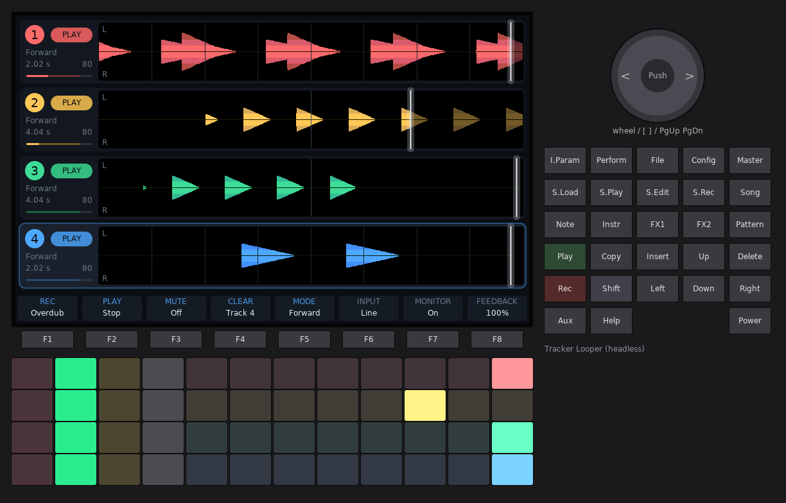

# Tracker Looper

A from-scratch 4-track looper firmware for the original Polyend Tracker. The
app is new; the hardware layer (board bring-up, SDRAM, FT81x display,
SGTL5000 codec, keypad, pad LEDs, SD card, USB) is copied from
[OpenTracker](https://github.com/sandlbn/polyend-tracker-re), MIT, the same
way [SIDTracker](https://github.com/sandlbn/SidTracker) does it. See
`PROVENANCE.md` for exactly what was copied.

Status: feasibility prototype. It builds a flashable image and runs in the
desktop simulator; **it has not been run on a Tracker yet.**



## Layout

| Path | What |
|---|---|
| `src/looper/engine.*` | The audio engine: 4 stereo tracks, master length, overdub, mute, jump. No hardware headers. |
| `src/looper/app.*` | Input, pad LEDs and the screen, drawn straight on the FT81x display list. |
| `src/looper/platform.h` | Everything the app needs from outside (display, audio, input, LEDs, clock, memory). |
| `src/device_main.cpp` | Device glue: HAL drivers + 16 MB SDRAM into `looper::Platform`. |
| `src/main.cpp`, `src/hal/`, `src/platform/` | Copied from OpenTracker (boot, drivers, display interface, fonts). |
| `sim/` | Desktop simulator: OpenTracker's host HAL plus a new `main.cpp` with a headless script runner. |

## Build

Needs `arm-none-eabi-gcc` + newlib, GNU make, Python 3 (firmware), and g++ + SDL2 (simulator).

```
make                 # build/PolyendTracLooperv01.ptf
make SELFTEST=1      # OpenTracker hardware selftest image
make sim             # build/sim/looper-sim
make -C sim check    # headless test scripts (sim/scripts), screenshots in build/sim/check/
```

`sim/scripts/stereo.txt` checks that left and right stay separate through
record, playback and overdub; `--tone-ch left|right|both` puts the simulator's
test tone on one channel when you run it interactively.

## Run the simulator

```
build/sim/looper-sim --tone 330      # synthetic input
build/sim/looper-sim --line-in       # the host microphone
```

Keyboard: the four rows `1..=`, `q..]`, `a..'`, `z../` are the pad rows
(row = track). Enter = Rec, Space = Play, Backspace = Delete, F1..F8, Up/Down,
mouse wheel = encoder. The panel is clickable.

## Controls

The screen is the four track lanes and, along the bottom, the labels of the
eight screen keys, each centred over its key as on the stock Tracker.

| Screen key | Action (selected track for F1–F5) |
|---|---|
| F1 REC | Record / finish / overdub / stop overdub |
| F2 PLAY | Play / stop the track |
| F3 MUTE | Mute on/off |
| F4 CLEAR | Clear the track; with Shift, all tracks |
| F5 MODE | Opens the mode bar: the eight labels become the playback modes and the key under one picks it. Any other key closes it. |
| F6 INPUT | Line in / mic low / mic high (the cell shows the input level) |
| F7 MONITOR | Tap: input monitoring on/off. Hold + encoder: input gain (a knob with the input level shows while held) |
| F8 FEEDBACK | Overdub feedback 100 / 90 / 75 / 50 % |

| Other control | Action |
|---|---|
| Pad column 1 | Record / overdub (empty → record → play ↔ overdub) |
| Pad column 2 | Play / stop the track |
| Pad column 3 | Mute |
| Pad column 4 | Clear |
| Pad columns 5–12 | Jump to that eighth of the loop, keeping the phase (stays in time) |
| Rec | Record / overdub the selected track |
| Play | Transport start / stop (restarts from bar 1); Shift + Play: metronome on / off |
| Delete | Clear the selected track; Shift + Delete clears all |
| Up / Down, any pad | Select track |
| Encoder | Selected track volume; Shift + encoder = input gain |
| Note | Home: the loop lanes, from any page |
| Master | Mixer page on / off |
| I.Param | Track options page on / off |
| Song | Track options page at the tempo column (BPM, metronome, click) |
| FX1 / FX2 | That effect slot's page on / off |
| S.Edit | Loop editor for the selected track |
| Help | Show / hide the CPU, frame-rate and display-list readout; Shift + Help: stress preset |
| Power (hold 1.5 s) | Switch off |

### Playback modes

Every mode's read position is computed from the shared bar clock, so tracks stay
in time whatever mode they are in. Switching modes carries on from the current
position instead of jumping.

| Mode | What it does | Overdub |
|---|---|---|
| Forward | Plays as recorded | yes |
| Reverse | Plays backwards | yes |
| Ping-pong | Forwards then backwards (one cycle = two loop lengths) | yes |
| Half speed | Tape style: half tempo, an octave down | no |
| Double | Tape style: double tempo, an octave up | no |
| Half time | Time-stretched: half tempo, same pitch (two cross-faded 46 ms grains) | no |
| Octave up | Pitch-shifted: same tempo, an octave up (grains) | no |
| Octave dn | Pitch-shifted: same tempo, an octave down (grains) | no |

Overdub needs speed 1 so it can write where it reads; in the other modes REC
shows a hint instead.

### Track options and tempo

The **I.Param** key opens the track options page: a column per track over
F1–F4 and the tempo column over F5 (same navigation as the mixer, F8 back).

| Option (per track) | Values |
|---|---|
| Stop | **Free**: the take ends when you press. **On bar** / **On beat**: it records on to the next bar / beat line (a press less than an eighth of a unit late stops on the line it just passed). Default On bar. |
| Length | Off, or a fixed length: recording stops by itself. Encoder in bars, Shift + encoder in beats. |
| Start | **Count-in** (default): one bar of click, then the take starts on the bar line; with loops running it waits for the next bar line at least half a bar away. **Now**: at once. **On sound**: the track arms and starts when the input crosses the threshold, keeping the 6 ms before it so the attack is not cut; with no loop yet the bar clock starts there. The armed lane shows the input level against the threshold. Press again to cancel. |
| Input | Stereo, Mono L, Mono R, Mono sum. Mono uses half the memory, so a track holds about 44 s. Only while the track is empty. |
| After rec | Play, Overdub or Stop when the take ends. |

| Tempo column | |
|---|---|
| Tempo | 40–240 bpm (default 120). It sets the bar until there is a loop; after that it shows the loop's tempo. |
| Beats / bar | 1–12 (default 4): the click, on-beat stops and the beat lines. |
| Metronome | Click on every beat while the transport runs (the count-in always clicks). Also Shift + Play. |
| Click | Click level. |
| Threshold | Input level that starts an "on sound" take, −60 … 0 dB (default −30 dB). |

A free first take still sets the bar to its own length, as before; an on-bar,
on-beat or fixed-length first take keeps the tempo's bar. Every waveform shows
the bar lines (numbered) and the beat lines where they fall in that take.

### Performance mode

**Perform**: tap it to latch performance mode on (tap again to leave), or hold
it to use it only while held. Each lane's waveform shows eight effect cells,
laid out like pad columns 5–12 of that track's row. Hold a pad to play its
effect on that track; Shift + pad latches it (a dot in the cell) until pressed
again. Leaving performance mode turns everything off. Pad columns 1–4 keep
record / play / mute / clear.

Each effect has one knob: **hold its pad and turn the encoder** (a big knob
shows while held). The knobs are shared by the four tracks; each cell shows its
setting.

| Pad column | Effect | Knob (default) |
|---|---|---|
| 5 Repeat | Beat repeat: loops the note it was pressed in, on the beat grid | Length 1/4, 1/8, 1/8T, 1/16, 1/16T, 1/32 (1/8) |
| 6 Repeat | A second repeat | Length (1/16) |
| 7 Low-pass | Resonant low-pass cut | Cutoff 80 Hz – 8 kHz (450 Hz) |
| 8 High-pass | Resonant high-pass cut | Cutoff 100 Hz – 8 kHz (1.8 kHz) |
| 9 Sweep dn | Low-pass sweeping 18 kHz → 200 Hz while held | Time 1/4 – 4 bars (1 bar) |
| 10 Sweep up | High-pass sweeping 20 Hz → 4 kHz while held | Time (1 bar) |
| 11 Vibrato | 5.5 Hz pitch wobble | Depth (50) |
| 12 Tape stop | Slows to a stop | Time 1 beat – 2 bars (2 beats) |

The repeats, vibrato and tape stop move the read position while the loop's
phase keeps running underneath, so releasing them lands back in time. Overdub
pauses while one of those is held. Effects stack (a low-pass and a high-pass
together make a band-pass). Sends take the effected sound.

The pads are single-colour (brightness only), so the pad grid shows state as
brightness and blinking: REC fast blink while recording, slow blink while
overdubbing, a flash per beat in the count-in; PLAY lit while playing; MUTE
full when muted; columns 5–12 the playhead's eighth, or in performance mode
the running effects.

### Loop editor

**S.Edit** opens a big waveform of the selected track (Up/Down for another)
with a start and an end marker. The selection is bright, the rest dim; the bar
and beat lines are drawn over it, and the markers read bar.beat.sixteenth from
the loop start.

| Key | Action |
|---|---|
| F1 START / F2 END (or Left / Right) | Pick the marker the encoder moves |
| F3 SNAP | Marker steps: bar, beat, 1/16 or free (10 ms); Shift + encoder: a quarter step (free: 1 ms) |
| F4 TRIM | Keep only the selection. Instant and non-destructive: the loop just starts and ends at new points in its buffer, and the kept part stays where it was on the bar grid |
| F5 CUT | Remove the selection; the rest closes up and the loop gets shorter. Press twice. The track is silent for the moment the audio takes to move |
| F6 ERASE | Silence the selection, same length. Press twice |
| F7 UNDO | Undo the last trim (a cut clears it, since the audio has moved) |
| F8 HOME | Back to the lanes |

### Mixer and send effects

Two send effect slots, FX 1 (a delay to start with) and FX 2 (a reverb). Every
track has a post-fader send to each. Either slot can hold any of five effects:

| Effect | Knobs |
|---|---|
| Delay | Time (1/32 … 3/4 of a bar, glides like tape when changed), Feedback, Tone (of the repeats), Spread (right side later) |
| Ping-pong | Time, Feedback, Tone, Width: the echoes cross from side to side |
| Reverb | Size (decay 0.3–9 s), Tone (dark … bright), Width |
| Chorus | Rate (0.1–5 Hz), Depth, Width |
| Flanger | Rate (0.05–2 Hz), Depth, Feedback, Manual (0.5–8 ms) |

**FX1 / FX2** open that slot's page: a live picture of the effect on top (the
echo taps on the beat grid, the reverb's decay, the LFOs moving) and its knobs
below, each over its screen key. **F1 TYPE** opens the type bar (the labels
become the five effects; the key under one picks it). **F2–F5** pick a knob,
**F6** the return, **F7** the other slot, **F8** home; Left/Right move between
knobs and the encoder turns the selected one. Changing the type silences the
slot for about 0.2 s while its delay line is cleared.

The **Master** key opens the mixer page: seven strips, each over its screen
key, plus F8 home.

| Strip (key) | Top row | Middle row | Fader |
|---|---|---|---|
| Track 1–4 (F1–F4) | Send to FX 1 | Send to FX 2 | Track level |
| FX 1 (F5), FX 2 (F6) | The slot's first knob | Its second knob | Return level |
| Master (F7) | – | – | Master level |

F1–F7 or Left/Right pick a strip, Up/Down a row (the row stays when you change
strip), the encoder sets the value, Shift + encoder in single steps. Faders
show their level meter; the master shows left and right. Sends start at 0,
returns at 80, track levels at 80, master at 100. Mixer settings stay when a
track is cleared.

Tracks are stereo. Each lane draws the left channel above its centre line and
the right channel below it.

Every take starts in phase with the bar grid; how it ends is the Stop option
on the track options page (on bar by default).

## Install on a Tracker

First run on hardware: follow `docs/DEVICE_TEST.md` (way back, serial
telemetry, what to measure).

Same as OpenTracker: copy the `.ptf` to `/Firmware` on the SD card and use
the stock firmware updater. Keep `PolyendTracker_1.9.2.ptf` on the card as
the way back: write its name into `/Firmware/ot_restore.txt` and power-cycle
(the check runs before the app starts).

## Limits found so far

- **Memory:** 16 MB SDRAM = about 22.1 s of stereo audio per track (after the
  1 MB of the two FX slots' delay lines), with no
  undo. Mono storage or a shared pool would roughly double that; longer loops
  need SD streaming (the SD → SDRAM DMA path is still unverified in the HAL).
- **Display list:** the FT81x runs at most 2048 words (8 KB) per frame. This
  screen uses about 900. Waveforms are RGB332 bitmaps in the display's 1 MB
  RAM_G (13 words each to draw), so detail does not cost display-list space.
- **SPI:** bitmaps reach RAM_G over a 30 MHz SPI link. A recording lane
  re-uploads 43 KB at 20 Hz, about 0.7–0.9 MB/s.
- **Input latency:** recordings are not yet shifted to make up for the
  codec's in → out delay (OpenTracker measured 10–14 ms on live resampling).
- **Not yet:** save/load to SD, MIDI clock, undo, per-track effects.
