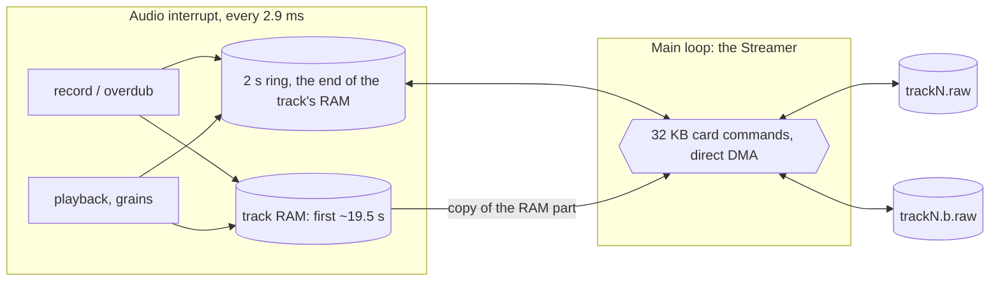

# Retrack: reference

The rest of the [README](../README.md): the source layout, building and the
simulator, every control, and the deeper details (projects, long takes and
the SD card streaming, MIDI, transport rules, releases, installing, limits).

## Layout

| Path | What |
|---|---|
| `src/looper/engine.*` | The audio engine: 4 stereo tracks, master length, overdub, mute, jump. No hardware headers. |
| `src/looper/app.*` | Input, pad LEDs and the screen, drawn straight on the FT81x display list. |
| `src/looper/stream.*` | Long takes on the SD card, the main loop's side: the stream files, read-ahead, write-back, undo, edit jobs. |
| `src/looper/files.*` | Settings, projects (save / load) and WAV export, as background jobs. |
| `src/looper/manual.h` | The on-device manual (Song). |
| `src/looper/platform.h` | Everything the app needs from outside (display, audio, input, LEDs, clock, memory). |
| `src/device_main.cpp` | Device glue: HAL drivers + 16 MB SDRAM into `looper::Platform`. |
| `src/main.cpp`, `src/hal/`, `src/platform/` | Copied from OpenTracker (boot, drivers, display interface, fonts). |
| `sim/` | Desktop simulator: OpenTracker's host HAL plus a new `main.cpp` with a headless script runner. |

## Build

Needs `arm-none-eabi-gcc` + newlib, GNU make, Python 3 (firmware), and g++ + SDL2 (simulator).

```
make                 # build/PolyendTracLooperv01.ptf, also in build/sdcard/Firmware/ (copy that folder onto the SD card)
make SELFTEST=1      # OpenTracker hardware selftest image
make sim             # build/sim/looper-sim
make -C sim check    # headless test scripts (sim/scripts), screenshots in build/sim/check/
make -C sim asan     # build/sim-asan/looper-sim: the simulator with AddressSanitizer + UBSan
make -C sim soak     # long random sessions on the asan build (SEEDS="1 2 3" MINUTES=60)
```

**Soak.** `looper-sim --soak SEED --minutes N` plays a random user for N
minutes of simulated time (about 30x faster than real time): pads, keys,
the encoder, held keys and pads, the input changing, long takes on a slow
simulated card, tap tempo, every page, and every ten minutes a project saved,
loaded back and compared. After every action it checks each track's state
and loop bounds, card errors and the display-list size; the asan build stops
at the first bad memory access. The same seed replays the same session, and
`--soak-log FILE` lists every action with its time. Run a few seeds before a
release.

`sim/scripts/stereo.txt` checks that left and right stay separate through
record, playback and overdub; `--tone-ch left|right|both` puts the simulator's
test tone on one channel when you run it interactively.

## Run the simulator

```
build/sim/looper-sim --tone 330      # synthetic input
build/sim/looper-sim --line-in       # the host microphone
tools/readme_shots.sh                # the README screenshots (docs/img), from example loops
```

Scripts can feed a WAV file into the input with `input_wav PATH` (16-bit,
44.1 kHz, mono or stereo, looped; `input_wav off` stops it).

Keyboard: the four rows `1..=`, `q..]`, `a..'`, `z../` are the pad rows
(row = track). Enter = Rec, Space = Play, Backspace = Delete, F1..F8, Up/Down,
mouse wheel = encoder. The panel is clickable.

## Install on a Tracker

First run on hardware: follow [`docs/DEVICE_TEST.md`](DEVICE_TEST.md) (way back, serial
telemetry, what to measure).

Same as OpenTracker: copy the `.ptf` to `/Firmware` on the SD card and use
the stock firmware updater. Keep `PolyendTracker_1.9.2.ptf` on the card as
the way back.

From the looper itself: Config > F1 Firmware, pick the image, F1 twice. If the
looper does not start, there is also the boot-time route: `/Firmware/ot_restore.txt`
holding an image name is flashed at power-on (the check runs before the app
starts, and the file is renamed `ot_restore.done`). `make` writes
`build/sdcard/Firmware/` with the image and an `ot_restore.txt` naming it, so
copying that folder onto the card and power-cycling installs the build.

## Releases

GitHub Actions (`.github/workflows/build.yml`) builds only release tags:
pushing a tag `vX.Y` (one digit each, since the image name must be exactly 24
characters) builds version X.Y, runs the simulator checks and publishes a
release with `PolyendTracLooperv<XY>.ptf` and an SD-card zip. Plain pushes
don't build; Actions > build > Run workflow makes a test build (the image as
the run's artifact, no release). The build is reproducible: the same commit
gives a byte-identical image here and on CI.

```
git tag v0.2
git push origin v0.2
```

## Controls

The screen is the four track lanes and, along the bottom, the labels of the
eight screen keys, each centred over its key as on the stock Tracker. The whole
interface is greys and one colour: every page is plain black with no cards or
boxes, and whatever is selected (a lane, a row, a strip, a knob, a picked
mode) is drawn in the yellow of the DIY norns shield's OLED, the rest
in dimmer greys; on the lanes only the selected track's waveform (or its line,
when empty) turns yellow. The four tracks are told apart by slightly different greys (only
the popups over the lanes keep a backing, to stay readable). The lanes
are waveforms only, the full width of the screen; a tag in each lane's corner
gives its name (when it has one), its length and, when they apply, **card**
(a long take), its mode (other than Forward) and Muted. The bar and beat lines
sit faintly behind the waveforms; while a track records or overdubs, in every
fourth bar of the take (bars 4, 8, 12 ... from its start; overdubbing, of the
loop) a thin line at the right end of its
lane brightens slowly through the bar, so the end of the four bars can be seen
coming (nothing while only playing).
Pages carry no instructions: the screen keys' labels say what they do. A lane that records has a pulsing dot before its tag (a ring
while it is armed or counting in). The selected track's state is on the keys: REC lights up while it
records (brightest, pulsing; a softer pulse for an overdub, dim during a count-in
or while armed), PLAY lights while it plays (dim while it waits for its bar line), MUTE
while it is muted.

| Screen key | Action (selected track for F1–F3, F5, F7) |
|---|---|
| F1 REC | Record / finish / overdub / stop overdub |
| F2 PLAY | Stop: the track goes silent and back to its start. Play: it starts again from its start on the next bar line (press again to cancel) |
| F3 MUTE | Mute on/off |
| F4 TEMPO | Tap: metronome on/off (the label is bright while it is on). Hold + encoder: tempo, 1 bpm a step (a knob shows while held). Shift + hold + encoder: click level. Delete clears tracks |
| F5 MODE | Tap: the mode bar, two pages of playback modes; the key under one picks it, F8 in the bar turns the page (it opens on the page with the track's mode). Any other key closes it. Hold on a Granular track: the grain menu, which stays open (F1–F4 and F6–F7 pick a knob, the encoder turns it, F8 is blank, F5 closes it) |
| F6 INPUT | Tap: the Input page (the cell shows the source and the input level). Hold + encoder: input gain (a knob with the input level shows while held) |
| F7 VOLUME | The selected track's volume, with its output level in the cell. Tap: its strip on the mixer (level, sends, filter). Hold + encoder: a volume knob (the encoder alone sets it too) |
| F8 UNDO | Undo the last overdub or replace; after an undo it reads REDO and brings it back |

**Input page** (F6): two cards. Up/Down pick a setting, Left/Right the card, the
encoder sets it (Shift: fine steps); F6 or F8 closes it.

| Input card | |
|---|---|
| Source | Line in / mic low / mic high |
| Gain | Codec input gain, with the live input level under it |
| Track N channels | Stereo / Mono L / Mono R / Mono sum for the selected track (only while it is empty) |
| Monitor | Hear the input through the outputs |
| Monitor FX | Off / FX 1 / FX 2 / Both (default): hear the input through the effects too, at the selected track's send levels (what a take on it will get); takes stay dry |
| Overdub feedback | How much of the loop stays under each pass, 0–100 % |

| Tempo card | |
|---|---|
| Metronome | Click on every beat (count-ins click either way) |
| Click level | Click volume |
| Click sound | Beep / wood block / hi-hat / cowbell |
| Accent | Beat 1 louder |
| Click | Always / only while recording |
| Count-in | Off / 1 / 2 / 4 bars |
| Tempo | As F4: the bar before there is a loop, tape speed after |
| Beats per bar | 1–12 |
| Stop fade | Off / 1 beat / 1 bar / 2 bars |

Quick keys on the page: F1 next source, F2 monitor on/off, F3 next channel
mode, F4 metronome on/off, F5 feedback 100 / 90 / 75 / 50 %.

**Shift layer.** Holding Shift on the home page relabels the F-keys; F5–F8
are the selected track's options (see [Track options and tempo](../README.md#track-options-and-tempo) in the README):

| Shift + | Action (selected track) |
|---|---|
| F1 REPLACE | Punch in: record over the loop instead of on top of it; again to stop |
| F2 ALL | Play / stop all (the transport, as Play) |
| F3 SOLO | Mute every other track; again: everything back |
| F4 CLICK | Hold + encoder: click level |
| F5 STOP | Tap: Free / On bar / On beat. Hold + encoder: a fixed length in whole bars, or off |
| F6 START | Tap: Now / Count-in / On sound. Hold + encoder: the sound threshold (with the input level) |
| F7 AFTER | Tap: Play / Overdub / Stop after the take |
| F8 TEMPO | Tap: Tape / Stretch |

| Other control | Action |
|---|---|
| Pad column 1 | Record / overdub (empty → record → play ↔ overdub); Shift + pad: replace |
| Pad column 2 | Stop / play the track, as F2 |
| Pad column 3 | Mute |
| Pad column 4 | Clear (performance mode: Freeze a Clouds slot) |
| Pad columns 5–12 | Jump to that eighth of the loop, keeping the phase (stays in time) |
| Rec | Record / overdub the selected track; Shift + Rec: replace |
| Insert | Undo the last overdub / replace (Shift: redo). In the editor: paste the copy, inserted at the start marker |
| Copy | Duplicate the selected track into the next one (empty), in time with it. In the editor: copy the selection; Shift + Copy (Paste): paste it at the start marker, over what is there |
| Encoder push | Tap tempo: three taps or more (before a loop: the bar; after: the tape speed) |
| Play | Transport: everything stops, or starts from bar 1 (what was playing plays, stopped tracks stay stopped); Shift + Play: metronome on / off |
| Delete | Clear the selected track; Shift + Delete clears all |
| Up / Down, any pad | Select track |
| Encoder | Selected track volume; Shift + encoder = input gain |
| Pattern | Home: the loop lanes, from any page; leaves performance mode |
| Perform / Instr | Performance mode |
| Master | Mixer page on / off (Shift + F8 there: name the strip's track) |
| Note / S.Edit | Loop editor for the selected track |
| S.Load | The sample loader: folders and WAVs on the card; Right / F1 opens a folder or loads the WAV into the selected track, Left / F2 up |
| FX1 / FX2 | That effect slot's page on / off |
| Config | Settings page (F1 firmware, F2 MIDI, F3 measure the recording latency) |
| File | Projects (save / load / name) and WAV export |
| Shift + Config | Show / hide the CPU, frame-rate and display-list readout (Help too, if the panel has one) |
| Shift + File | Stress preset (Shift + Help too) |
| Song | The manual: chapters on F1–F7, Up / Down or the encoder scroll, F8 home |
| Power (hold 1.5 s) | Switch off |

## Config, projects and export

**Config** opens the settings; Up/Down pick one, the encoder sets it. They are
saved to `Looper/config.bin` on the card a second after a change and loaded at
start-up: display brightness (low / medium / high), pad brightness, headphone
level, input source, input gain, input monitoring (these three are the same
settings as on the Input page) and **Rec latency**. The page also shows the
version and the recording time per track.

**Rec latency** (Config, last row; **F3** measures it): what comes in at the
input is late by the codec's round trip, so a take or an overdub played in
time would land that much late, and layers would drift. Playback reads that
far ahead of the bar clock and overdubs write at the clock, which puts them
back. Off by default. To set it, patch an output (line out or headphones)
into the input and press **F3**: the outputs go quiet but for seven short
clicks, the input times them, and the median is set and saved. The encoder
also sets it by hand, 0.5 ms a step (Shift: a frame), up to 30 ms.

**Config > F1 Firmware** lists the update images in `/Firmware` (the names the
update bootloader takes: `PolyendTrac*.ptf`, `mt*.hex`), with this looper's
image and the stock one marked. Up/Down or the encoder picks one, **F1 twice**
flashes it (the Tracker restarts into the updater; unsaved loops are lost),
F2 rescans the card, F7 back, F8 home. This is the way back to the stock
firmware or OpenTracker, and the way to install a new looper build.

**File** opens projects and export:

| Key | Action |
|---|---|
| F1 SAVE | Save over the current project (the first save makes a new one) |
| F2 SAVE NEW | Save as the next numbered project |
| F3 LOAD | Load the selected project (Up/Down); press twice, it replaces the loops you have |
| F5 EXPORT | The selected track as a WAV |
| F6 EXPORT | Every track with a loop as WAVs |
| F8 HOME | Back to the lanes |

A project is a folder `Looper/Projects/NNN`: `project.bin` and `trackN.wav` per
track with a loop (16-bit, stereo or mono as recorded). It holds the tempo and
bar, each track's length, place on the bar grid, play / stop, mode, level,
mute, sends and options, both FX slots, returns, master, the performance knobs,
the metronome and the feedback. Loading clears the tracks, reads the WAVs back
(progress bar) and leaves the transport stopped: Play starts everything from
bar 1. Exports go to a new folder `Looper/Export/NNN` each time (the highest
number on the card plus one, up to 999). Saving and exporting run in the
background in 16 KB steps, so the audio and the screen keep going.

A save writes new files next to the old ones (`trackN.tmp`, `project.tmp`)
and swaps them in only when all of them are written, so a save that fails
(a full card, the card pulled) leaves the last good save as it was; a power
cut during the swap is finished at the next load. While a job runs, the
tracks it still needs are held: recording is refused during a load, and
clearing, undo and the editor's edits on a track being saved or exported.
A load that has to leave a track out (an unreadable or non-44.1 kHz WAV, a
long take with no card ready) says which, and F1 then saves a new project
instead of overwriting the original.

## Stop, mute and starting things

- **Mute** keeps a track running in time, silently: unmute and it carries on
  where the loop is.
- **Stop** puts a track back to its start. A track's **Play** (F2, pad column 2)
  starts it from there on the next bar line (in its own place in the bar, if it
  starts off the line), so it comes in on the beat; **Rec** on a stopped track
  does the same and overdubs from that bar.
- **The Play key starts or stops everything together; Rec acts on the
  selected track only.** Rec never stops another track: with the transport
  stopped it starts it as Play does (the loops that were playing, from bar 1)
  and records or overdubs its own track. A track's Play (F2, pad column 2)
  with the transport stopped starts that track alone; the loops that were
  playing go to stopped, ready to start on a bar.

## MIDI

**Config > F2 MIDI.** The **Clock** row: Off, **Send** (24 ticks a beat on the
bar clock, so it follows the tape speed; Start and Stop with the transport; DIN
and USB), or **Follow** (Start / Stop / Continue run the transport, the tempo
follows the incoming clock: before a loop it sets the bar, after it the tape
speed, with a slow correction that keeps the bars on the clock's).

Below, eight actions to play from a footswitch or controller: Rec / dub,
Play / stop, Undo, Redo, Replace, Next track, Prev track, Play all. Pick one,
**F1 Learn**, press the pedal or key: any note (velocity > 0) or controller
(value ≥ 64, what a footswitch sends) on any channel, DIN or USB. **F2**
clears it. The bindings and the clock setting are saved with the settings.

## Long takes (on the SD card)


Above, track 1 is a 24 s take with the chord stabs overdubbed over its first
half (undo is ready on F8), next to two ordinary 4 s loops.

With a card in, a take that outgrows its RAM (past about 19.5 s stereo, 39 s
mono) keeps going onto the card, up to 5 minutes stereo or 10 mono per track.
Every take is written to the card as it records; one that grows past its RAM
keeps its first part there and streams the rest through a 2 s buffer, read
ahead of the playhead in whichever direction it plays. The lane's tag reads
**card**. Each track has two files, `Looper/Stream/trackN.raw` and
`trackN.b.raw` (53 MB each, 424 MB in all, allocated once when the card is
first seen and then kept).

A long take does everything a RAM loop does: overdub and replace, every
playback mode, any tempo, jumps (a moment of silence while the buffer
refills), the performance effects, the loop editor, saving, loading and
exporting. **Undo / redo**: an overdub pass writes the blocks it changes to
the track's other file, so the pass before stays there; undo switches back to
it (the track is silent for a moment while its RAM part reloads), redo
switches again. The editor's trim is instant; cut and erase work through the
card, so on a long take they take a few seconds (the track is silent
meanwhile). A project load puts a long track's first part in RAM and the
rest in its stream file. One difference: in **Granular**, grains on the card
part stay inside the 2 s buffer around the playhead, so Spread reaches about
a second either way there instead of the whole loop.

The card matters: see [The SD card](../README.md#the-sd-card) in the README.

## How the SD card streaming works

The design notes, measurements and phases are in [`docs/SD_STREAMING.md`](SD_STREAMING.md);
this is the short version.

**Two threads, one rule.** The audio runs in an interrupt every 128 frames
(2.9 ms) and must never wait, so it never touches the card: it only reads
and writes the Tracker's 16 MB SDRAM. Everything on the card is done by the
main loop (`Streamer`, `src/looper/stream.cpp`), one card command per track
per pass. They share a small block of atomics per track
(`StreamView` in `engine.h`): who owns which part of the memory, how far the
card has caught up, what the ring holds.



**Files.** Each track has two stream files on the card, A and B, 53 MB each
(5 minutes of stereo), created with FatFs's `f_expand` as one contiguous run
of clusters without writing any data, and kept from then on. The files
mirror the track's buffer frame for frame, so a frame's place in the file is
just its index times 4 bytes (2 for mono). FatFs's fast-seek map keeps
jumping around in them free of FAT lookups.

**Recording.** Every take with a stream file ready is copied to file A as it
records (a short one simply stops being copied when it ends). A take that
reaches `head`, its RAM less the last 2 s, becomes a long take: from there on
the frames go into a 2 s **ring** in that last part of its RAM, and the
Streamer drains the ring to the file in 32 KB commands. If the card falls a
whole ring behind (2 s), the take ends there rather than lose audio in the
middle; the end of the last bar is padded with zeros on the card.

**Playback.** The first `head` frames play straight from RAM. The rest play
from the ring, which the Streamer keeps filled from the file around the
playhead: from 0.5 s behind it forwards when it reads forwards (the half
second behind is there for beat repeats and grains), from 0.5 s after it
backwards in the reverse modes. While a loop plays its RAM part, the ring is
already filled with what comes next on the card: the start of the card part,
or its end for a reverse loop about to wrap. A frame the ring does not hold
plays as silence and is counted (`under` in the telemetry): a jump pad into
the card part does that for a moment while the ring refills.

**Overdub.** An overdub mixes into RAM or the ring, then marks the 32 KB
**block** it changed. A changed block goes back to the card once the
playhead has left it, as one 32 KB command; before the ring moves (a jump,
the loop's wrap) it is emptied first, so the overdub stops writing into it,
and every changed block is written back before its slots are reused.

**Undo on the card.** The Streamer keeps a map of which file, A or B, holds
the current version of each block. An overdub pass writes each block's
first change to the *other* file and flips the block in the map, so the
version from before the pass stays untouched in the first file. Undo writes
everything back, flips that pass's blocks back, reloads the RAM part's
blocks from the card, recomputes their waveform and refills the ring; redo
flips them again. Like the RAM undo it is one level: the next pass starts a
new set.

**Edits, projects.** A trim only moves the loop's start and end over the
buffer (the file mirrors the buffer), so it is instant. Cut and erase are
Streamer jobs that work through RAM and the card (cut moves the rest of the
take up through a 32 KB staging buffer); saving and exporting read the take
the way it plays now (RAM, the ring where an overdub has not gone back yet,
each block's current file); loading writes a long WAV's first part to RAM
and all of it to file A.

**Granular** grains read either the RAM part or the ring, each grain wholly
one or the other: a grain is kept off the RAM part's edge and the loop's
end, and inside what the ring holds, with its own length to spare because
the ring moves on while it plays.

**Speed.** On the 8 GB test card formatted with 32 KB clusters, with direct
DMA into the SDRAM (verified on the device: thousands of transfers, every
word checked), in-place writes ran at 8 MB/s and reads at 16 MB/s, the
worst write stall 166 ms. Four tracks playing need 0.7 MB/s, four
overdubbing 1.4 MB/s, so the card is busy a small part of the time and the
2 s ring rides out the stalls. Card commands block the main loop while they
run (~2–4 ms for 32 KB), which the screen and pads can afford; the audio
never waits. The serial telemetry line ends with
`stream under N over M err E` (frames played as silence, takes cut short,
failed card commands).

## Limits found so far

- **Memory:** 16 MB SDRAM = about 21.5 s of stereo audio per track (after the
  1 MB of the two FX slots' delay lines and the long-take waveforms); a RAM
  loop's undo needs it to fit in half of that, so a loop between about 10.8 s
  and 19.5 s keeps its undo on the card instead (without a card: none). Mono
  tracks double it. Copy / paste works on loops in RAM up to half the memory (duplicating a
  track works on any, long takes too: a card job of a few seconds). Longer takes go to
  the SD card (5 minutes stereo), undo included (it uses the card's second
  file). Internal SRAM: about 243 of 256 KB in use.
- **Long takes:** up to 5 minutes (the stream files' size). Granular's Spread
  on the card part reaches about the 2 s ring around the playhead. A beat
  repeat or tape stop there takes the ring with it while it lasts; releasing
  one held a while is like a jump pad (a moment of silence while the ring
  refills at the playhead). Cut and
  erase on a long take take a few seconds. A long take trimmed to start past
  its RAM part, and longer than the 2 s ring, has a few milliseconds of gap
  at each loop wrap (the ring reloads there). A card with small clusters
  (4 KB) is too slow: format with 32 KB clusters.
- **Display list:** the FT81x runs at most 2048 words (8 KB) per frame; the
  busiest pages (four lanes with performance cells, the effect pages) use
  about 1700. Waveforms are L8 bitmaps in the display's 1 MB RAM_G (13 words
  each to draw), so detail does not cost display-list space.
- **SPI:** bitmaps reach RAM_G over a 30 MHz SPI link, a blocking write on
  the main loop. A recording or overdubbing lane sends only the columns that
  changed (tens of KB/s); a whole lane (68 KB) only when it comes on screen
  or its scale changes.
- **Input latency:** compensated once Rec latency is set (Config > F3 with a
  patch cable); off until then. The default will be the Tracker's measured
  value once there is one.
- **Not yet:** per-track insert effects.
